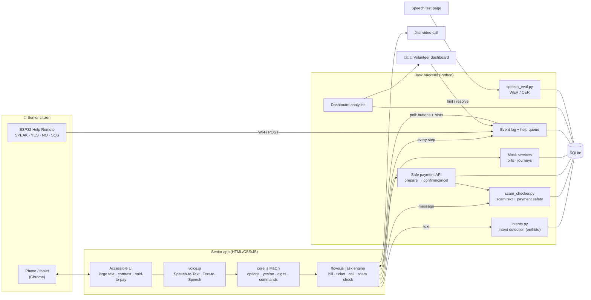
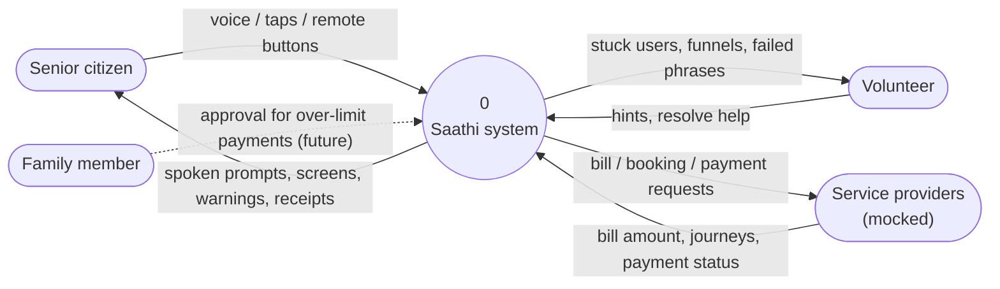
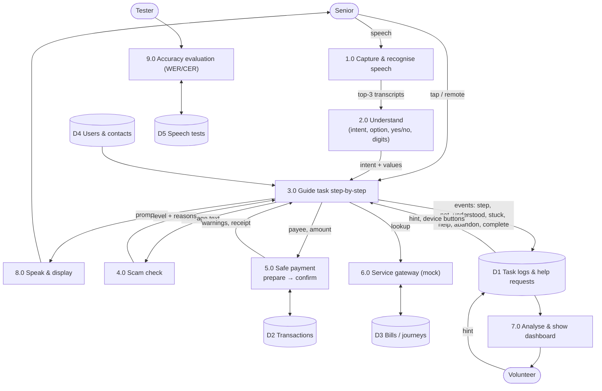
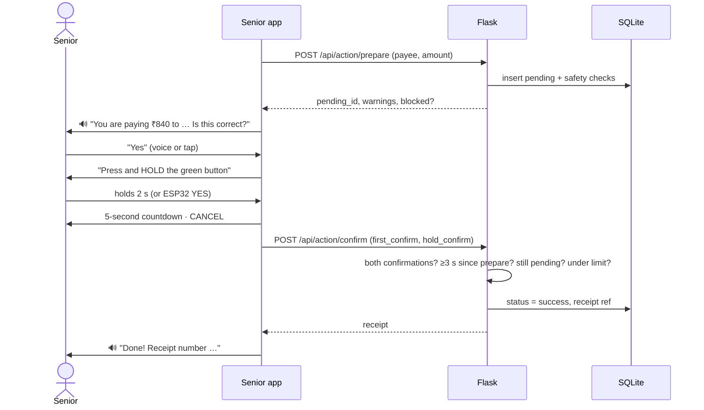
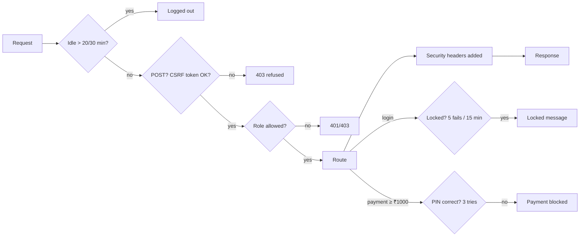

# System Design & Data Flow — Saathi

> Diagrams are written in Mermaid. They render directly on GitHub, or paste them into https://mermaid.live to export PNG/SVG for slides.

## 1. Architecture

**Layers (as in the proposal):** Accessibility interface → AI & language layer (STT, TTS, intent, translation via per-language strings) → Task manager (`flows.js` step engine) → Safety & scam checker → Guided workflow with confirmation → External services (mocked) → Database → Volunteer dashboard & analytics.

## 2. Data-flow diagram — Level 0 (context)

## 3. Data-flow diagram — Level 1

## 4. Safe payment sequence

## 5. Database (SQLite)

| Table | Purpose |
|---|---|
| `users` | name, language, text size, family contact, daily limit, mobile number, hashed PIN |
| `volunteers` | name, email, hashed password |
| `contacts` | video-call contacts (name, relation, colour) |
| `saved_billers` | saved consumer numbers per bill type |
| `bills` | mock biller data |
| `transactions` | every payment attempt: pending / success / cancelled / blocked, warnings, both confirmation flags |
| `task_logs` | every step event — the source for funnels, drop-offs, stuck detection |
| `help_requests` | HELP presses (kind volunteer/family/fraud), volunteer hints, resolved status |
| `transactions.reason`, `transactions.stop_stage` | why a payment did not go through (limit · pin_blocked · user_cancelled · left) and where (confirm · hold · pin · countdown) — shown on the History page |
| `contacts.trusted` | the senior's trusted contact for the help sheet |
| `device_events` | ESP32 button presses |
| `speech_tests` | accuracy test recordings with WER/CER and intents |

## 6. API summary

| Method | Path | Use |
|---|---|---|
| GET | `/` | welcome page — choose Senior Citizen or Volunteer |
| GET/POST | `/login/senior` · `/login/volunteer` · `/logout` | sign in (mobile + PIN / email + password, both hashed) — Flask session holds the role |
| GET | `/app` (senior) · `/volunteer`, `/speech-test` (volunteer) | role-protected pages |
| GET/POST | `/api/me`, `/api/me/language` | the logged-in senior's profile and saved language |
| GET | `/api/user/<id>`, `/api/contacts/<id>` | profile, saved billers, contacts |
| POST | `/api/intent` | text → intent + scam check |
| POST | `/api/scam/check` | message → danger / caution / safe + reasons |
| GET | `/api/bill`, `/api/journeys` | mock services |
| POST | `/api/action/prepare` · `/confirm` · `/cancel` | safe payment (PIN for ₹1,000+) |
| GET | `/api/history` | senior: own payments (paid / failed / stopped + reason + stage) and tasks left half-way · volunteer: everyone, or `?user_id=` |
| POST | `/api/doc/read` | bill/letter reader — PDF (pypdf), photo (Tesseract OCR), or text → kind, biller, amount, due date, days left, number, units, scam check. In-memory only, 8 MB limit |
| POST | `/api/log`, `/api/help` (kind: volunteer · family · fraud), `/api/help/<id>/hint`, `/api/help/<id>/resolve` | events & help |
| POST/GET | `/api/device/button`, `/api/poll` | ESP32 remote & hint delivery |
| GET | `/api/dashboard` | dashboard analytics |
| POST/GET | `/api/speechtest`, `/summary`, `/export.csv` | accuracy testing |

## 7. Security layer (`security.py`)

## 8. Production path

| Prototype | Production |
|---|---|
| Web Speech API (Chrome) | Bhashini / AI4Bharat IndicConformer ASR + Indic TTS, on-device noise suppression (RNNoise) |
| Keyword intent rules | Fine-tuned IndicBERT / small LLM with the same intent set; rules kept as fallback |
| Mock bills & journeys | BBPS (Bharat BillPay), IRCTC/APSRTC/TSRTC partner APIs, UPI via a licensed PSP |
| SQLite | PostgreSQL, encrypted PII, audit log |
| Polling | WebSockets / push notifications |
