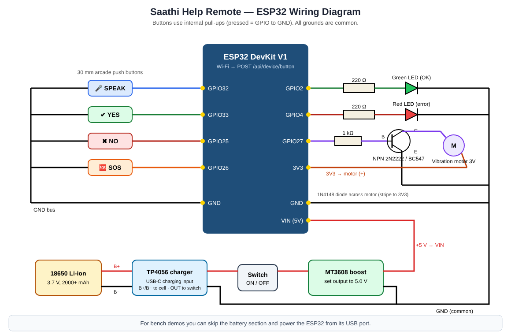

# Hardware — Saathi Help Remote (ESP32)

A palm-sized remote with four big buttons for users with low vision or hand tremor. It talks to the Saathi server over Wi-Fi, so it works alongside any phone or tablet running the app.



## Bill of materials (approx. ₹900–1,200)

| # | Part | Qty | Notes |
|---|---|---|---|
| 1 | ESP32 DevKit V1 (30/38-pin) | 1 | Wi-Fi + Bluetooth |
| 2 | 30 mm arcade push buttons (blue, green, red, orange) | 4 | large, easy to feel |
| 3 | Coin vibration motor 3 V | 1 | haptic feedback |
| 4 | NPN transistor 2N2222 / BC547 | 1 | drives the motor |
| 5 | 1N4148 diode | 1 | across motor (flyback) |
| 6 | Resistors 1 kΩ ×1, 220 Ω ×2 | 3 | transistor base, LEDs |
| 7 | LEDs green + red (5 mm) | 2 | status |
| 8 | 18650 Li-ion cell + holder | 1 | optional for portable use |
| 9 | TP4056 USB-C charger module (with protection) | 1 | optional |
| 10 | MT3608 boost converter (set to 5.0 V) | 1 | optional, feeds VIN |
| 11 | Slide switch, jumper wires, enclosure | — | 3D-printed or project box |

## Pin map

| ESP32 pin | Connected to |
|---|---|
| GPIO32 | SPEAK button → GND |
| GPIO33 | YES button → GND |
| GPIO25 | NO button → GND |
| GPIO26 | SOS button → GND |
| GPIO2 | 220 Ω → green LED → GND |
| GPIO4 | 220 Ω → red LED → GND |
| GPIO27 | 1 kΩ → transistor base; emitter → GND; collector → motor (−); motor (+) → 3V3; 1N4148 across motor |
| VIN | +5 V from MT3608 (or USB power) |
| GND | common ground |

Buttons use the ESP32's **internal pull-ups**, so no extra resistors are needed.

## Firmware

`hardware/esp32_help_remote/esp32_help_remote.ino`

1. Install Arduino IDE → Boards Manager → **esp32 by Espressif**.
2. Open the sketch and set `WIFI_SSID`, `WIFI_PASSWORD` and `SERVER_URL` (your laptop's IP, port 5000).
3. Select **ESP32 Dev Module**, upload, open Serial Monitor at 115200 baud.
4. Press a button → Serial shows `Sent yes -> HTTP 200`, the motor buzzes and the green LED blinks.

**Tremor filtering in firmware:** 40 ms debounce, a press must last ≥ 120 ms, and repeats of the same button within 800 ms are ignored.

## Test without hardware

```bash
curl -X POST http://localhost:5000/api/device/button -H "Content-Type: application/json" -d "{\"button\":\"yes\"}"
```
On a Yes/No screen the app moves on; on the hold-to-pay screen it counts as the hold.
